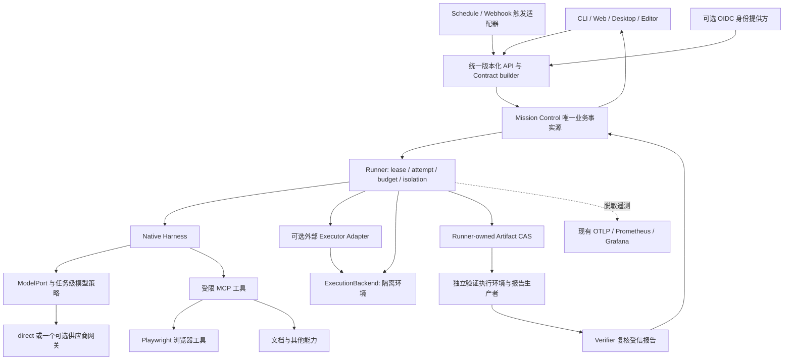

# AgentHub 可组合 Agent 平台建设方案

> Status: accepted\
> Owner: architecture and platform maintainers\
> Last reviewed: 2026-10-17\
> Scope: 开源组件选型、执行与验证边界、统一入口、多 Agent、记忆、后台触发和交付阶段\
> Baseline: AgentHub `c318099`；外部资料核对日期 2026-10-17\
> Related decision: [ADR-0118 accepted](../architecture/decisions/0118-composable-agent-integrations.md)

## 1. 建设方向

AgentHub 应保留已有 Mission Control，组合成熟的开源执行、浏览器、文档、身份与观测组件，形成一个可自托管、可替换执行器、结果可独立验证的 Agent 工作平台。

首个交付目标是：用户提出仓库任务，系统在受限工作区内产生真实补丁，由独立运行者执行验收，最后展示改动、测试、费用、证据和待决策事项。第二条业务线再扩展到带来源引用的网页调研和文档任务；后台执行复用相同 Mission 链路。

组件组合的收益来自替代重复实现。每次接入必须回答：替代哪段责任、由谁维护、增加哪些运行依赖、如何验收，以及如何卸载。组件数量、角色数量、界面数量不作为完成度指标。

本文为已获批准的实施方向，阶段交付仍须通过各自验收，不将 PoC 候选描述为已经接入。现有 [架构边界](../architecture/components/system-boundaries.md)、[CLI 技术规范](../architecture/production-cli-technical-spec.md) 和 [执行后续切片](execution-next-slices.md) 继续有效；冲突以契约、测试和当前实现为准。

## 2. 从 PilotDeck 借鉴什么

参考基线为 PilotDeck `52660d51a9292032ae9ca485eafb30175858741d`。其 [中文说明](https://github.com/OpenBMB/PilotDeck/blob/52660d51a9292032ae9ca485eafb30175858741d/README.zh.md) 强调工作区、白盒记忆、路由和后台运行。成本数字是该项目特定任务与配置下的声明，不作为 AgentHub 的预期收益或验收基线。

源码显示它有自有 TypeScript 执行主干；[package.json](https://github.com/OpenBMB/PilotDeck/blob/52660d51a9292032ae9ca485eafb30175858741d/package.json) 引入 MCP、Playwright MCP 和仓库内 memory package。因此应学习它如何在一个主干下整合能力，而不是把致谢列表视为可直接互换的依赖清单。

- **工作区是产品组织单位。** 将文件、会话、工具授权、产物和相关记忆绑定到明确项目。AgentHub 应复用现有 workspace 授权，并为每次 attempt 创建隔离执行视图。
- **记忆可解释。** 借鉴其 [Memory Provider 适配](https://github.com/OpenBMB/PilotDeck/blob/52660d51a9292032ae9ca485eafb30175858741d/src/context/memory/EdgeClawMemoryProvider.ts)，展示本轮注入了什么及其来源；保留 AgentHub L0/L1 和 facts 的轻量实现。
- **路由有独立边界。** 其 [RouterRuntime](https://github.com/OpenBMB/PilotDeck/blob/52660d51a9292032ae9ca485eafb30175858741d/src/router/RouterRuntime.ts) 分开决策、执行和用量观察。AgentHub 应区分任务级选型与供应商网关，先从可解释规则开始。
- **后台工作要产出可审阅结果。** 借鉴 [AlwaysOnRuntime](https://github.com/OpenBMB/PilotDeck/blob/52660d51a9292032ae9ca485eafb30175858741d/src/always-on/runtime/AlwaysOnRuntime.ts) 与 [WorkspaceApply](https://github.com/OpenBMB/PilotDeck/blob/52660d51a9292032ae9ca485eafb30175858741d/src/always-on/workspace/WorkspaceApply.ts) 的职责分离，在 AgentHub 中落实为触发、隔离执行、差异审阅和受控应用。
- **工具按协议扩展。** 复用 AgentHub MCP 边界和 Skill 目录，避免每个工具单独接一套 Agent 平台。

PilotDeck 根 [LICENSE](https://github.com/OpenBMB/PilotDeck/blob/52660d51a9292032ae9ca485eafb30175858741d/LICENSE) 是 AGPL-3.0。AgentHub 当前采用 Apache-2.0，近期采用公开设计思路和独立适配器；复制源码、携带其内置模块或再分发前，必须核对具体文件及依赖条款。进程隔离本身不自动解决许可证义务。

## 3. 基线问题与主链路修复

以下为 `c318099` 审计发现的扩展前置问题，不能由接入新组件替代。
M0 实现采用 [ADR-0119](../architecture/decisions/0119-default-task-artifact-acceptance.md)
的默认输出完整性验收和 [ADR-0120](../architecture/decisions/0120-development-service-failure-boundaries.md)
的服务失败边界；其测试不证明 M1 的可信代码测试、M2 外部执行器或团队生产已完成。

1. **统一验收合同。** [Chat 默认合同](../../app/api/v1/chat_mission/_helpers.py) 和 [桌面入口](../../desktop/ui/main.js) 使用空配置 manual criterion，无可用策略时进入等待决策，现有决策不能直接接受成功。应先提供统一 Contract builder 和可以完成的验收流程。
2. **让结果表达准确。** 当前 [Runner](../../app/services/_runner_service_impl.py) 默认发布模型 stdout；[本地 verifier](../../app/services/runner/controller.py) 默认 Artifact 完整性检查不能代替代码验收。新增可信补丁和测试生产者。
3. **打通输入与权限。** 修复 [Web 实际请求](../../frontend/hooks/useMissionChat.ts) 未传递附件/权限、[VS Code 请求](../../extensions/vscode-agenthub/src/agenthubClient.ts) 与服务端 DTO 不一致等问题。
4. **停止正式路径模拟成功。** 一键部署、MCP 失联降级、Go sandbox 无 Docker noop 等应明确不可用；演示模式必须显式选择并隔离结果。
5. **收紧执行和身份边界。** 修复 IAM 直接签发/管理接口授权、沙箱退化和多租户知识读写隔离。未修复的独立平台服务不进入团队 profile。
6. **建立可对账用量。** 补全价格缺失、子 Harness 漏计、并行额度预留和不确定请求结算。

2026-10-17 的本地基线审计运行得到 Python 1,986 passed / 47 skipped，另 439 subtests passed；前端 161 tests passed。它们提供回归基础，不证明上述用户流程和生产边界已经完整。该记录不是新组件的测试结果。

## 4. 目标架构和所有权

Mission Control 持有 Mission、Contract、WorkUnit、依赖、租约、预算账本、Artifact 元数据、Evidence 和 Decision。Runner 持有运行环境资源和私有恢复状态。CAS 保存字节；Verifier 只在获授权范围内读取。外部组件只持有其运行必需状态，不能更新 AgentHub 数据库或宣布 Mission 成功。

外部执行器中的 conversation、task、session、checkpoint 仅作为当前 WorkUnit attempt 的私有实现。上游 `done` 只表示执行结束，进入验证后才可能由 Mission Control 接受成功。

## 5. 组件选择与采用方式

### 5.1 必须保留的自有能力

保留 Mission Control、领域状态机、事务与租约、Contract 授权、Artifact/Evidence 准入、Decision、Runner 监督，以及现有 Native Harness。保留 Next.js 与 Tauri；不为参考另一个项目而重写 UI 技术栈。既有 `ModelPort`、`FunctionTool` 和 checkpoint 接口优先复用。

### 5.2 执行环境主选 PoC 为 OpenSandbox

[OpenSandbox](https://github.com/opensandbox-group/OpenSandbox) 作为 Runner 后面的独立执行环境，逐步替代自建 Go sandbox 的容器生命周期、文件和命令执行细节；模型不得直接访问其管理 API。根 [许可为 Apache-2.0](https://github.com/opensandbox-group/OpenSandbox/blob/main/LICENSE)。

接入前验证认证、命令超时、进程树取消、文件边界、租户隔离、资源配额、出站网络和孤儿回收。[官方配置](https://github.com/opensandbox-group/OpenSandbox/blob/main/docs/getting-started/configuration.md) 的可选 API Key 等默认值不能直接当生产配置。

Windows 保留客户端入口，通过 API 访问受支持 Linux 执行节点。WSL2/Docker Linux 容器作为本机候选单列验证；SDK 能运行在 Windows 不代表沙箱原生支持 Windows。Windows 原生构建采用单独的受限 runner，明确权限和不支持范围。

现有 Docker 后端在过渡期先改为失败关闭。远端不可达时不切换普通本地执行；可信本地开发模式必须由用户选择，与强隔离 profile 分开。

### 5.3 编码执行器保留 Native，比较一个 OpenHands 候选

[OpenHands Software Agent SDK](https://github.com/OpenHands/software-agent-sdk) 提供模块化 Agent/Tools/Workspace/Server，根 [许可 MIT](https://github.com/OpenHands/software-agent-sdk/blob/main/LICENSE)。将其作为一个 WorkUnit 的可选执行器进行对照，不同时接入整个 OpenHands 产品、自动化平台和 UI。

采用独立进程/Agent Server 适配，隔离 Python 版本与依赖。核对时其 [SDK 配置](https://github.com/OpenHands/software-agent-sdk/blob/main/openhands-sdk/pyproject.toml) 要求 Python >=3.12，而 AgentHub 声明最低 3.11；不能直接加入主应用依赖并假设兼容。

只有工具权限、取消、真实用量、产物、环境身份和版本固定均能纳管时，才进入受支持目录。PoC 没有收益则保留 Native，不以“必须换框架”为交付要求。

### 5.4 浏览器采用 Playwright，按调用用途分层

[Playwright](https://github.com/microsoft/playwright) 用于固定、可重放的浏览器验收；[官方 Playwright MCP](https://github.com/microsoft/playwright-mcp) 供 Native Harness 探索网页和执行授权操作。两者根许可 Apache-2.0。MCP 不再引入一个隐藏模型循环。

固定版本，按 tenant/mission/attempt 分配隔离浏览器会话。不要默认复用用户日常 Chrome 和 cookie。[官方安全说明](https://github.com/microsoft/playwright-mcp#security) 明确 MCP 不是安全边界；origins 配置、输出脱敏不能替代 Runner 网络与文件授权。发布、提交、购买、发送等外部动作采用独立能力和审批策略。

对于编码任务，也可在同一 ToolPort 后比较官方 CLI+Skill 方式的上下文开销；这是同一浏览器能力的不同适配，不同时暴露两套重复工具。

### 5.5 Skills 采用开放格式，内容逐包审核

兼容 [Agent Skills 格式](https://agentskills.io/specification)，采用 metadata discovery、需要时读取正文和资源的渐进加载方式。Skill 本身没有授予工具或网络权限的效力。

首批自行维护三个小包：仓库修复、代码评审、来源可追溯调研。记录来源 URL、commit、内容 digest、版本、许可证及需要的能力。远程 Skill 和 MCP Server 安装须显式选择，不能由网页或模型回答自动安装。

[标准仓库](https://github.com/agentskills/agentskills) 区分 Apache-2.0 代码和 CC-BY-4.0 文档。[Anthropic Skills 说明](https://github.com/anthropics/skills#about-this-repository) 明确 document skills 中 docx/pdf/pptx/xlsx 为 source-available，不能把整个仓库当作均可按 Apache 开源再分发的包。

### 5.6 模型网关保持可选，同层选一个

沿用 [ADR-0104](../architecture/decisions/0104-optional-newapi-llm-gateway.md)：默认直连已有 Provider adapter；可选 new-api。新增需要时比较 LiteLLM Proxy，配置为 `direct | new-api | LiteLLM`，不把多个网关串联。

AgentHub 决定模型能力档、允许的供应商/区域、价格和降级范围；网关处理通道与协议；Mission Control 管理任务树预算。所有层共用总截止时间和重试上限，避免叠加放大。

[new-api 当前根许可 AGPLv3](https://github.com/QuantumNous/new-api/blob/main/LICENSE)，并有 [NOTICE](https://github.com/QuantumNous/new-api/blob/main/NOTICE)；保持可选部署，不直接复制其业务/UI 代码。新增发行包是否携带需核对具体交付方式。

[LiteLLM 根许可](https://github.com/BerriAI/litellm/blob/main/LICENSE) 将 `enterprise/` 排除在 MIT 核心之外。只评估所需社区功能和实际发行内容，不把所有功能或整个镜像泛称 MIT。

ClawXRouter 的策略思路用于研究：先实现可解释的按角色/能力规则，后做对照评测；暂不把另一套框架 hooks 和记忆路由直接嵌入 Harness。[官方项目](https://github.com/OpenBMB/ClawXRouter) 的包声明与完整许可、依赖清单在正式采用时重新锁定核对。

### 5.7 验证采用真实测试工具和一个可选扫描器

复用项目自己的 pytest、Vitest、Go/Rust tests 以及 Playwright。由独立 Verification Runner 执行冻结命令，适配已有 `test-run` 报告契约。

[Trivy](https://github.com/aquasecurity/trivy) 可作为首个安全扫描生产者，根许可 Apache-2.0。它覆盖依赖/镜像/配置/secret 等检查，但不能证明不存在全部安全问题。冻结扫描器版本、漏洞库版本、规则和目标 snapshot；数据库不可用或过期时结果为未知/失败，不生成“无发现”成功。

### 5.8 文档解析和知识库为后续可选能力

[Docling](https://github.com/docling-project/docling) 是文档解析候选，以独立 worker 或受限 MCP 接入。核心 MIT，模型/额外依赖有独立许可。输出原文引用、页码/位置、解析版本和内容 digest；它负责解析，不接管 Mission 或默认记忆。

向量 RAG 先修现有 tenant 过滤、写入 point 命名空间、删除传播和维度迁移。明确业务收益前，默认仍使用 L0/L1、facts 和关键词/全文检索。UltraRAG/完整记忆框架可作实验候选，不进入首期依赖。

### 5.9 身份和观测复用成熟基础设施

个人本地模式保持最少依赖；团队模式接现有 OIDC 身份提供方，无现成服务时以 [Keycloak](https://github.com/keycloak/keycloak) 为候选，根许可 Apache-2.0。它解决登录和身份交换，AgentHub 继续执行 workspace ACL、Runner/Verifier 服务主体和 Contract 能力授权。

默认保留现有 OTLP/Prometheus/Grafana。[Langfuse](https://github.com/langfuse/langfuse) 只作后续可选 LLM trace/评测界面；[其许可](https://github.com/langfuse/langfuse/blob/main/LICENSE) 区分 MIT 核心和 EE 路径。遥测不作为任务状态或计费事实源，不默认导出 prompt、源码、cookie、工具参数和密钥。

### 5.10 暂缓或仅作备选

- [E2B Embed](https://e2b.dev/resources/introducing-e2b-embed)：2026-09-30 发布的自托管 microVM 方案，要求 Linux/KVM/Docker；后续强隔离场景备选，不作为 Windows 轻量默认安装。
- [Daytona 当前公开仓库](https://github.com/daytonaio/daytona)：已声明核心转私有、公开仓库不再维护；不选为长期自托管主底座。
- [browser-use](https://github.com/browser-use/browser-use)：MIT 库，但完整 Agent 自带模型循环；确有任务质量收益时以独立 Executor 纳管，不藏在普通工具里。
- [ACP](https://github.com/agentclientprotocol/agent-client-protocol)：后续编辑器互操作候选；是 editor-agent 协议，不替代 A2A/MCP/WorkUnit。先修现有 VS Code API，再增加该协议。
- 首期不叠加多个 Agent 编排框架，不引入第二任务数据库、默认图谱记忆、开放插件市场或完整集群调度平台。

## 6. 适配契约和运行流程

以下为拟议设计，不是现有 v1 已发布字段。实施时优先扩展现有接口；只有语义确有差异才新增端口或契约。

### 6.1 统一入口和合同

CLI/Web/Desktop 共用 Contract builder 和 API client。输入含目标、workspace、结构化附件 ArtifactRefs、权限意图、模型 profile 和验收 profile。服务器取 workspace ACL、Contract 范围与执行器能力的交集；客户端权限选择不能直接授予权限。

代码任务要求可执行的测试策略。文字/研究任务明确区分结构检查和独立内容复核。需要人工接受时，单独定义人工验收命令、授权、理由、产物 digest 和 Evidence 语义；禁止把人工接受伪造成自动测试通过或直接改 Mission 终态。

现有 DecisionResolution 和消费者不能被静默扩充为支持 `ACCEPT`。若新语义对旧消费者不兼容，发布新契约版本并做双版本读取/投影；旧 Mission 保留其 Contract revision，不原地改写验收标准。

### 6.2 三类扩展

- **Skill：** 声明式流程与资源，不授予权限；脚本执行仍经过工具网关。
- **Tool/MCP：** 有界操作，无隐藏 Agent 循环；接收单次执行上下文并返回结果/ArtifactRefs。
- **Executor：** 单个 WorkUnit attempt 内的完整执行环；必须声明取消、用量、工具控制、隔离、产物和恢复能力。

现有 pluggy 原生 hook 只用于受信任代码。第三方未审代码不在 Mission Control 进程内导入；采用受限独立进程或 MCP 服务。元数据登记与运行时 Secret 分离。

### 6.3 ExecutionBackend 与 Executor

Runner 保持 lease fence、deadline、预算和资源回收。ExecutionBackend 只负责环境 create/exec/cancel/collect/destroy；外部 Executor 通过受限环境完成任务。二者状态不写入业务事实表。

请求绑定 Mission、WorkUnit、attempt、lease、Contract revision、输入 ArtifactRefs、workspace snapshot、能力、预算预约、执行器版本和截止时间。lease token、Provider key 与控制面凭据不进入模型上下文或公共日志。

事件可含 progress、tool receipt 引用、usage、artifact proposal 和 execution finished；上游 success 只映射成待验证。Runner 重新验证归属与字节后才注册 Artifact。迟到的旧 attempt 事件、失效 lease 和重复回执不能改变当前执行。

恢复能力按执行器真实支持声明为 `none`、`inspect-only`、`native-resume` 等候选等级。外部 checkpoint 不冒充现有私有 v2 恢复镜像；切换执行器以新 attempt/WorkUnit 完成，不透明搬运旧内部会话。

### 6.4 可信补丁与验证

拟议 execution manifest 作为既有 Artifact 保存，包含基线 commit（非 Git 场景可空）、包含脏文件的输入 snapshot digest、输出 tree/patch digest、锁文件/镜像 digest、执行器版本及报告引用。只记录 commit SHA 不足以表示已有用户改动。

1. 基于用户当前工作区建立有边界的执行快照，保留并识别已有改动。
2. Agent 在独立工作区产出补丁与候选产物。
3. Runner 固化候选补丁字节，在 WorkUnit 仍为 RUNNING、仍持有有效 lease 时调用独立报告生产者。
4. 生产者以独立服务身份在干净环境重建相同 snapshot，应用同一补丁，运行执行前冻结、位于 Agent 可写范围外的测试/扫描规则。
5. 生产者返回实际退出码、结果明细、工具/规则版本、被测 snapshot 引用及可验证的生产者回执。它不持有执行 lease，也不自行向当前 WorkUnit 注册 Artifact。
6. Runner 验证来源，登记补丁、报告和最后生成的 immutable manifest；全部产物绑定同一 WorkUnit/attempt。之后才 complete，将 WorkUnit 转至 VERIFYING。
7. Verifier 独立读取已注册字节和生产者回执、复核策略，Mission Control 在事务内准入 Evidence。
8. 用户查看 diff 和 Evidence；应用补丁时逐文件核对 expected digest，发生并行修改则停止并展示冲突。

首期明确沿用现有 Artifact 注册窗口：只有 RUNNING 与有效 owner lease 可注册。VERIFYING 后不补登记报告，也不让 Verifier 借用 Runner lease。若后续需要异步验证产物或独立验证 WorkUnit，先定义对应授权、产物引用和状态转换契约，再启用该路径。

执行 Agent 自己新增的测试可以作为补充产物，但不能成为唯一验收依据。报告 digest 证明完整性；可信生产者身份和独立运行记录补足执行来源。网络、计时和外部服务依赖另记可复现条件。

## 7. 多 Agent 和模型路由

首期模板为 Implement → Review → Test；每个角色是持久 WorkUnit。控制平面创建依赖，模型只提交受模式约束的计划建议；计划需验证环、数量、权限、预算和可用执行器。独立 Verifier 保留最终成功准入权。

每个子任务绑定输入 ArtifactRefs、产物、能力、预算、深度和并发限制。子任务权限不能扩大父 Contract；兄弟任务不能共享可写工作区。评审使用候选补丁只读视图，问题作为结构化反馈 Artifact，不能把“评审已完成”误记为“代码已通过”。各角色合同需明确 `workUnitKinds`、验收策略和最终代码测试归属；Review 记录不替代最终补丁测试。

首版固定一次 Implement → Review → Test。受限返工若在同 Mission 内实现，必须由新的显式编排命令在终局验收前创建后续 WorkUnit，校验依赖、预算和产物版本；负面反馈不能提前提交成终局 FAIL Evidence 后再尝试复活。当前 FAIL Evidence 会使 Mission 进入不可逆 FAILED，后续修复由用户重新授权新任务；“验收 FAIL 后原地重试”需要单独状态机 ADR。每次候选变更产生新产物，旧 Evidence 不自动适用于新版本。

先按角色和能力静态选模型：解释/规划、局部实现、评审分别使用经评测的 profile。视觉、长上下文、工具调用、数据区域和价格是硬约束；失败后只允许在合同范围内升级。

任务级策略决定模型类别；一个可选网关负责供应商通道。分类器、隐藏重试、子 Agent、评审和验证模型的调用全部计费。所谓“主强子弱”是待评测策略，不预先承诺某个节费比例。

预算按 Mission 原子预约、按调用/子任务结算、释放未用额度。超时、断流、取消不能当作零费用；重复回执不能重复扣账。缺价格或 usage 显示 unknown/estimated/pending，不填零。硬 token/调用上限与最终金额对账分开表达；严格金额 profile 在无法保守预约时拒绝新付费调用。

## 8. 工作区记忆与后台执行

### 8.1 可追溯记忆

保留 [L0/L1 与项目 facts](../architecture/components/memory.md)。会话和 Mission 事件保持不可变；facts 编辑只改变事实版本/当前视图，不能修改历史验收记录。给 facts 和摘要补来源引用、覆盖范围、生成时间、workspace、输入版本和失效信息。

用户可以查看本次 Context Manifest：哪些事实/摘要/文件被选中、来自哪里、占用多少上下文。模型自动提取先形成候选事实；明确授权策略或人工确认后再写入。摘要整理先产生候选版本和差异，支持恢复旧视图，不能覆盖唯一原始历史。

现有 `.agenthub/memory.md` 的扁平键语义保留；若新增版本存储，由专项 ADR 定义唯一事实源和原子更新方式，不同时维护两份可写记忆。Dream 类整理后续作为有预算、可暂停、可回滚的普通 Mission，而非常驻隐形循环。

### 8.2 受控 Always-on

触发器只把 schedule/webhook 转为 Mission，不自行执行模型或持有 WorkUnit 状态。首批支持一个明确的定时规则和一个仓库事件来源，不自动创建真实外部通知或定时任务。

规则含 workspace、来源、目标、授权人、能力、验收、单次/每日预算、并发、冷却、截止时间、timezone、错过触发策略和暂停开关。模型可以提出规则，不能自行扩大授权。

Webhook 去重使用 tenant/connector/event/rule；定时使用 tenant/trigger/scheduled instant。规则版本记录在 provenance 中，不能仅通过改版本绕过去重。接收回执与 Mission 创建在同一事务或可靠 inbox/outbox 中实现；不声称整个外部副作用链天然恰好一次。

默认后台只读、产出报告/补丁。发送、发布、合并和部署需要对应授权或 Decision。仅在结果、失败或需要决策时通知；暂停规则不新增 Mission，已存在工作按显式取消策略处理。

## 9. 部署形态

- **local：** CLI/Web + Python Mission Control + SQLite + Native Harness + 本地 Artifact store。浏览器和文档能力按需安装。普通本地进程仅用于明确受信工作，未提供强隔离时禁用要求 sandbox 的执行。
- **isolated：** 在 local 基础上连接受支持 Linux ExecutionBackend 与独立验证运行环境。Docker/后端缺失直接不可就绪；不静默退化。
- **team：** PostgreSQL、OIDC、分离服务主体、共享 Artifact store、验证 worker、持久化/备份/迁移与监控。模型网关、向量检索、Langfuse 按需启用。

NATS、Redis、Qdrant、OpenSearch、Kubernetes 不作为个人首次运行的前置条件。只有已被真实消费者需要的服务进入 profile。现有全平台 Compose 明确作为开发集成入口，生产配置另有认证、网络、数据卷和恢复验收。

## 10. 分阶段交付和停止条件

估算假设四名全职工程师分别负责控制面/契约、执行与验证、前端客户端、集成测试与部署，产品/架构负责人部分投入。以 Windows 客户端 + Linux 执行环境、CLI/Web 主入口为范围；单租户受控试用目标约 16 周，属于排期假设，验收门槛优先于日历。多租户生产与全面发行由后续独立门槛控制。两人团队应缩到前三个里程碑，并按实际吞吐重新排期。

### M0 第 1 至 2 周：先让同一任务正确完成

统一 Contract builder、Chat/Desktop 验收和输入 DTO，修扩展请求或暂时停用未接通入口。隔离演示数据；Go sandbox 无后端失败；封闭 IAM 直接暴露；知识服务未完成租户修复前不进 team profile。

验收：同一任务从 CLI/Web 得到一致执行与验收状态；失败、取消、无 Runner、策略缺失、依赖不可用都不假成功。需要人工决策时，存在可以完成的处理流程。停止条件：尚有假成功或无法处理的默认任务，则不扩组件。

### M1 第 3 至 5 周：可信产物和执行环境

实现补丁 manifest、独立测试生产者、被测 snapshot 绑定和报告映射；生产者在 RUNNING lease 窗口返回可信报告，由 Runner 登记完整产物后再进入 VERIFYING。完成 OpenSandbox PoC 与 Native Harness 接线。先修成本口径和基础预算预约，避免接入后无法计量。

验收：同一补丁在独立环境可复现；篡改报告/补丁、旧 attempt、失效租约、测试失败全部阻止成功；取消终止实际进程；用户原有改动不被覆盖。停止条件：后端不能证明所需隔离或报告来源，则停留显式实验 profile。

实施时将 M1 拆成可独立验证的切片：可信本地测试产物和 OpenSandbox
conformance 实验、Mission 持久预算账本、逐次供应商请求的严格计量接线，
以及受支持执行环境的组合验收。切片通过不等于整个 M1 完成。
账本必须先在服务端完成并发预约、幂等结算和未知用量保留额度的验证；
后续模型接线须为每次真实 HTTP 请求单独预约并记录用量，包含重试。
现有适配器的隐式重试、共享用量字段和未下传的请求输出上限不能作为
严格预算依据。只有完整接线验收后才能声称任务树预算已生效。

### M2 第 6 至 8 周：第二执行器和可复用工具

接入一个 OpenHands 候选或经 PoC 证明更合适的同类执行器；首批 Skills 和 Playwright 工具接入现有网关。执行器只完成单 WorkUnit，不提前开放自治分工。

验收：相同固定任务集比较 Native/候选的正确率、耗时、费用、权限与取消；换执行器不改 Mission 模型。候选未提供收益或无法纳管则停用，主线 Native 不受影响。

### M3 第 9 至 12 周：受控协作和任务级路由

Implement/Review/Test 持久工作流、输入产物交接、结构化评审反馈、预算并发预约、静态角色模型配置。受限返工按前述显式命令和终局 FAIL 边界单独验收。补白盒 Context Manifest；Docling 和来源引用调研作为可并行的限定插件试点，不阻塞代码主线。

验收：子任务不扩大权限；并发预约不超分；取消传播；旧补丁的验收不适用于新补丁；同一任务集对比单 Agent 和多 Agent。停止条件：没有质量或人工介入收益，默认仍单 Agent，协作继续实验。

### M4 第 13 至 16 周：有限后台执行和受控试用

一个 schedule 来源、一个 webhook 来源、幂等回执、每日预算、规则暂停；在隔离的单租户环境做真实任务试用，补备份和恢复记录。桌面/VS Code 只复用已稳定客户端，不把全面签名发行作为这四周的承诺。

验收：重复事件不重复执行；重启不丢已接收事件；暂停后不新建任务；无授权不发布/发送；额度与结果可以核对；受支持 Windows 客户端和 Linux 节点完成真实任务与恢复。停止条件：后台权限、幂等或成本不可解释，则只开放人工触发。

### M5 后续独立排期：团队生产与发行

在试用结果上安排 OIDC/service principal、共享存储与租户隔离、迁移/备份恢复演练、签名发行、升级回滚和运维值守。现有 IAM/RAG 缺口未修复的服务继续禁用。跨平台全面发布另行评估。

验收：跨租户查询和产物读取被拒绝，服务身份可撤销，Secret 轮换有效；干净机器安装升级回滚、生产拓扑和数据恢复有当前版本证据。该门槛通过后才能推广到 team profile；不把 16 周受控试用等同生产 GA。

## 11. 首批实施任务

建议按以下 reviewable slices 建 issue/PR；本方案未创建外部 issue 或安装组件。

1. `Contract builder + unified acceptance`：改 app/services/mission、chat API、CLI/Desktop 调用；补 domain/API/SQLite/前端契约测试。人工验收语义另作明确版本决策。
2. `Honest execution and inputs`：修 Go sandbox noop、UI 模拟路径、附件/权限 DTO、VS Code 请求；默认不可用优于伪结果。
3. `Artifact execution manifest + trusted test producer`：独立生产者在 RUNNING 窗口执行，Runner 登记绑定真实代码 snapshot 与报告的产物，Verifier 在 VERIFYING 后读取复核；更新 versioned contract 和消费者。
4. `Budget reservation + usage receipts`：父子全树配额、价格版本、幂等结算和 unknown handling；独立于显示报表。
5. `ExecutionBackend adapter`：在 app/services/runner 范围接 OpenSandbox；如需要独立 worker，在 services 下按已有 runtime 组织，不新增顶层目录。
6. `Executor comparison`：Native 与一个外部执行器的版本清单、能力矩阵、取消和产物适配；以 feature flag 开启。
7. `Skills + browser tools`：扩已有 plugins、MCP、工具注册；固化包来源与能力，不引入全局任意权限。
8. `Persistent role workflow`：将临时 child Harness 演进为受 Mission Control 管理的 WorkUnit，再启用路由和返工。
9. `Context provenance + trigger inbox`：分别交付记忆来源 UI 和幂等触发适配；不混成第二个任务引擎。

每个 slice 改责任时更新最近 README；改变 ownership、协议、持久化或部署时补独立 ADR。候选计划名称和路径不代表已经创建这些模块。

## 12. 验收数据与组件准入

建立冻结任务集：先用现有 8 题作 smoke，再增加至少 30 个仓库任务，区分 Python/TypeScript/Go、跨文件修复、权限拒绝、失败和恢复；另设独立调研/浏览器任务集。调参集与保留集分开，不依据失败结果改写保留集检查器。

每次比较固定代码版本、模型配置、执行器、环境镜像、依赖、验收与价格版本；记录重复运行的分布，而不是只报最好一次。至少跟踪独立验收通过率、误报成功、人工介入、真实 token/成本、总耗时、取消收尾和故障恢复范围。

零误报成功、零跨租户读取、零已知预算超分是限定测试矩阵中的准入目标，不推导成任意环境绝对保证。动态路由启用前设质量非劣阈值与费用改善门槛，基于实测决定；PilotDeck 节费数字不直接搬作指标。

组件进入发布清单前记录：官方来源、固定 tag/commit、镜像/包 digest、许可/NOTICE/模型条款、支持平台、数据出站、能力、Secret 引用、维护责任、健康状态、回归集和回滚方法。安装脚本不追随 `latest`；来源无法确认或测试未通过时保持实验状态。

## 13. 回滚和完成定义

能力开关只影响新任务准入。停用组件后，已有任务完成、取消或显式失败，不跨执行器透明搬运。保留历史 Artifact/Evidence/Contract 版本；不删除子任务关系、不修改已运行合同以制造通过。

采用 expand/contract 迁移，先兼容读写再切消费者。废弃执行路径先停止新增写入，再观察和移除；不能回滚到模拟成功路径。外部副作用依靠回执与明确补偿流程，数据库回滚不能假装撤销已经发送或发布的动作。

首个候选版本完成的标志是：普通用户从 CLI/Web 提出真实任务，系统通过 Native 或一个受支持执行器产生可审阅补丁，独立验收可推翻 Agent 的完成声明，权限和预算生效，失败可解释，历史可追溯，安装和限定恢复可复现。组件生态在这条主流程上逐步扩展。
